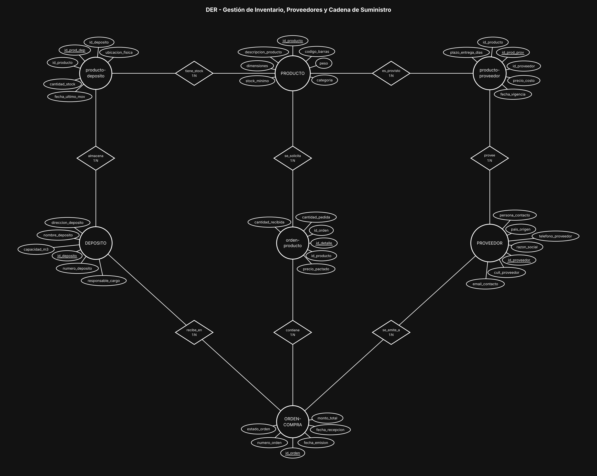
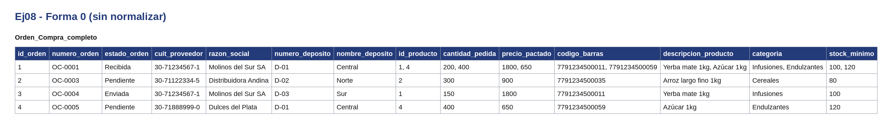
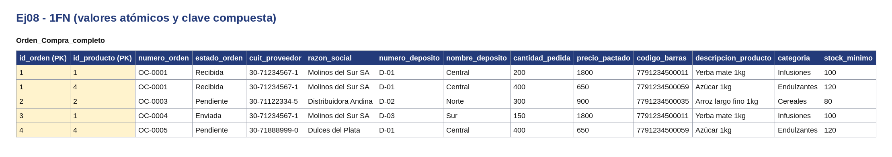
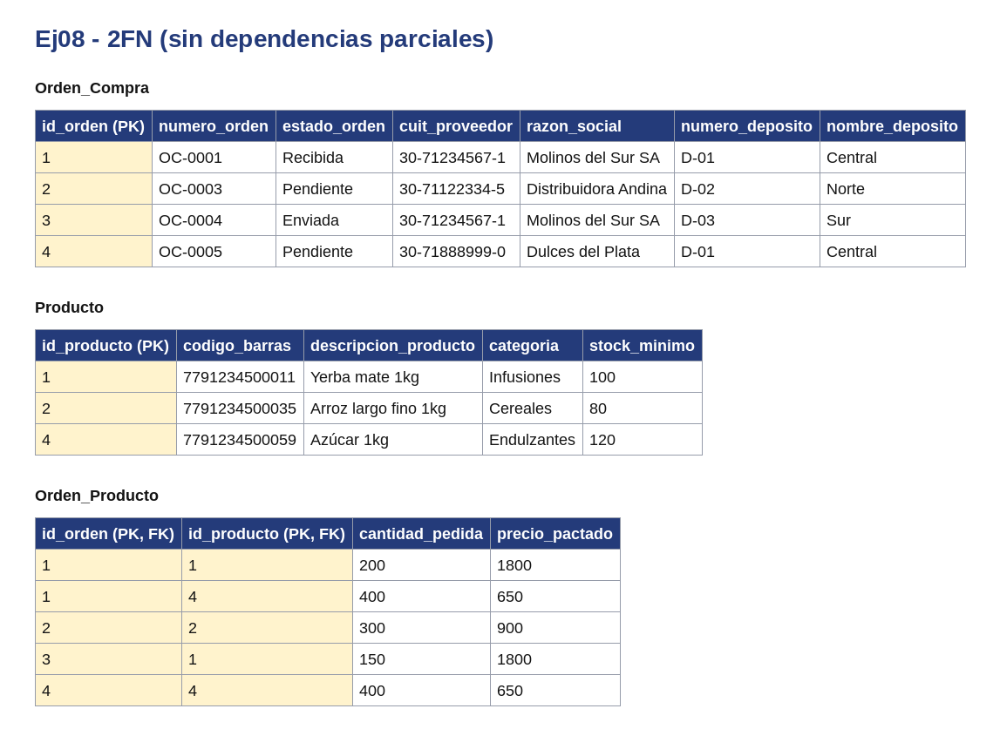
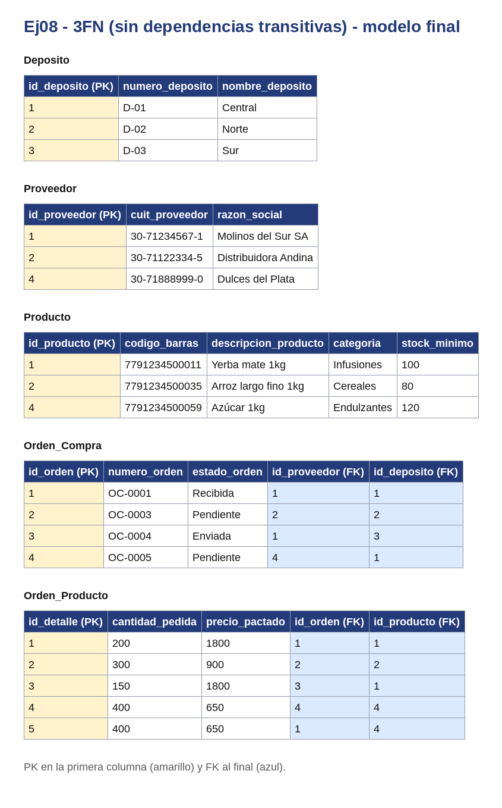

# BaseDeDatos-U1-Ej08-CadenaSuministro

Base de Datos - Unidad 1 - Ejercicio 8

## Consigna

Modelar la cadena de suministro de una mayorista de electrónica: depósitos, catálogo de productos, stock por depósito, proveedores internacionales con su precio de costo por producto, y órdenes de compra con su detalle de ítems.

## Lógica

**Producto ↔ Depósito: N:M con `producto-deposito`.** El stock no es un atributo del producto (sería un único número global, inútil para operar) ni del depósito (no se sabría de qué artículo). `cantidad_stock` es atributo de la combinación producto + depósito, que es exactamente lo que pide el enunciado. `ubicacion_fisica` (pasillo/estante) va en la misma intermedia por el mismo motivo: el mismo producto ocupa distinta posición en cada almacén.

**Producto ↔ Proveedor: N:M con `producto-proveedor`.** Un producto lo proveen varios y un proveedor entrega varios. `precio_costo` pertenece al vínculo, no a las entidades. Se agregó `fecha_vigencia` porque el costo de un proveedor internacional cambia seguido y conviene poder identificar qué precio estaba vigente.

**Orden de compra con detalle (`orden-producto`).** La orden es la cabecera (número, fecha, estado, proveedor y depósito de destino) y `orden-producto` es el detalle línea por línea, con `cantidad_pedida` y `precio_pactado`. El precio pactado se guarda en el detalle y no se lee de `producto-proveedor`: el costo de lista cambia, pero lo que se pactó en esa orden tiene que quedar congelado para poder auditarla después.

**Depósito de destino como relación, no como texto.** La orden se relaciona N:1 con DEPOSITO (`recibe_en`) y N:1 con PROVEEDOR (`se_emite_a`). Esto cierra el circuito: se sabe a qué almacén físico impacta la mercadería cuando llega.

**Integridad para que la recepción actualice el stock correctamente:**

- `cantidad_recibida` está en el detalle, separada de `cantidad_pedida`. Sin ese par no se pueden detectar entregas parciales ni faltantes.
- El stock que se incrementa es el de la fila de `producto-deposito` que cruza el `id_producto` del detalle con el `id_deposito` de la cabecera de la orden. Si esa fila no existe (primera vez que ese producto entra a ese depósito), hay que crearla antes de sumar; si no, el movimiento se pierde.
- Sobre las dos intermedias conviene declarar UNIQUE compuesto en sus FK (`id_producto` + `id_deposito`, `id_producto` + `id_proveedor`) para que no existan dos filas de stock del mismo producto en el mismo depósito, que es la forma más común de que los números dejen de cuadrar.
- La actualización tiene que ser transaccional: sumar stock, actualizar `cantidad_recibida` y pasar la orden a Recibida se confirman juntos o no se confirma nada.
- Solo deberían sumar stock las órdenes en estado válido, y una orden ya recibida no debería poder volver a procesarse (control de estado, para evitar duplicar el ingreso).
- Restricciones de dominio: `cantidad_stock >= 0`, `cantidad_recibida <= cantidad_pedida`, y los productos del detalle deberían existir en `producto-proveedor` para el proveedor de esa orden (no se le puede pedir a un proveedor algo que no provee).

**Nota sobre trazabilidad.** El contexto menciona lotes de mercadería, pero el desarrollo requerido no los pide. Si se quisiera trazabilidad completa se agregaría una entidad LOTE (número de lote, fecha de vencimiento, orden de origen) entre la recepción y el stock, y `producto-deposito` pasaría a llevar el detalle por lote.

**Convención de claves.** Toda entidad lleva como PK un identificador propio `id_<entidad>` (subrayado en el diagrama) y al menos 5 atributos además del id; el código o documento de negocio (`dni`, `codigo_*`, `legajo`, etc.) queda como atributo común con restricción UNIQUE. Las entidades intermedias de las relaciones N:M llevan los tres ids: el propio y las dos FK de las entidades que unen (UNIQUE compuesto sobre ambas FK). Atributos agregados para llegar al mínimo de 5 y que no figuran en la consigna: `monto_total` en ORDEN-COMPRA.

## Resultado

---

## Normalización

Se normaliza el documento `Orden_Compra` con sus registros de `Orden_Producto`. En todas las tablas la PK va en la primera columna y las FK al final. Los datos son de ejemplo.

**Forma 0.** Una sola tabla con todo junto. Hay celdas con listas: cada orden compra puede tener varios registros de orden producto.

**1FN.** Cada elemento de la lista pasa a su propia fila y la clave queda compuesta: (`id_orden`, `id_producto`).

**2FN.** Los datos de orden compra dependen solo de `id_orden` y los de producto solo de `id_producto`. Se separan en `Orden_Compra` y `Producto`; `Orden_Producto` queda con la clave compuesta y lo que depende de ambos.

**3FN.** Los datos de `Proveedor` y `Deposito` dependen de su propio identificador y no de la PK de orden compra, así que pasan a tablas aparte. En el modelo final cada tabla usa su id propio.

Para que se vea la lista en la Forma 0, se agregó un registro de ejemplo en `Orden_Producto` para el orden compra 1.

---

## SQL

El script `script.sql` crea las tablas con sus claves primarias y foráneas y carga datos de ejemplo. Está probado en SQLite (con `PRAGMA foreign_keys = ON;`).
